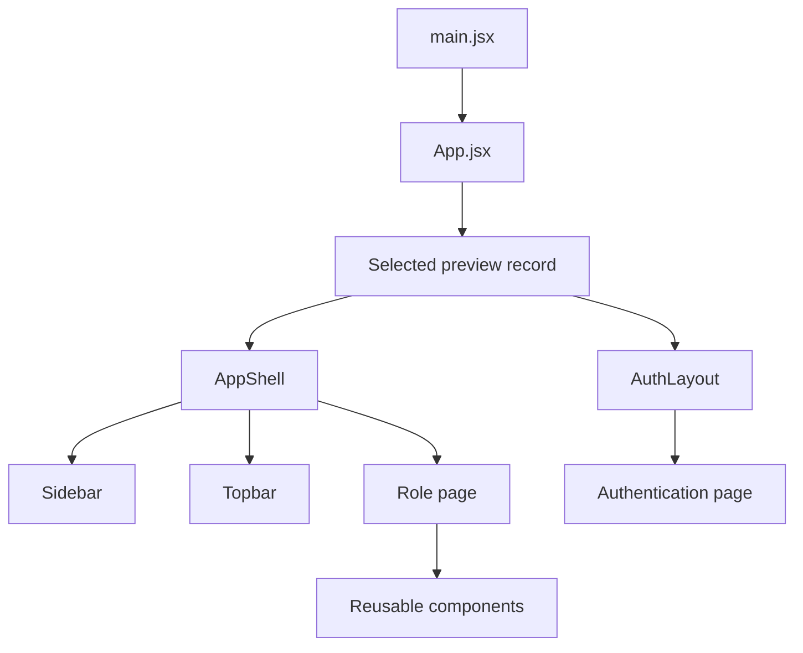
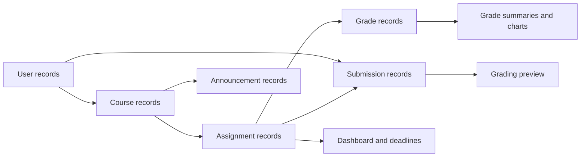

# MyLMS frontend

A static React and Vite interface for a small educational organization. The design uses a shared application shell, Inter typography, blue accents, white surfaces, and plain CSS. It provides 32 page previews across authentication, student, instructor, and administrator views.

Controls are visual specimens. They do not navigate, submit, upload, grade, filter, save data, or contact a backend. Native inputs accept text. Native selects and checkboxes retain their browser behavior. No React event handlers, hooks, routing, or state management are implemented.

## Start the project

Use Node.js 20.19+ or 22.12+ and a working npm installation.

```sh
npm install
npm run dev
```

Open the local address printed by Vite. For a production build:

```sh
npm run build
npm run preview
```

If you use pnpm, replace `npm install` with `pnpm install` and use `pnpm dev` or `pnpm build`.

Inter loads from Google Fonts. The system font stack is the fallback when the network is unavailable. All six SVG illustrations are local files. They need no network connection.

## Select a page preview

Open `src/App.jsx`. Change this single declaration:

```jsx
const preview = previewPages.studentDashboard;
```

For example, to inspect grading:

```jsx
const preview = previewPages.gradeSubmission;
```

Save the file. Vite refreshes the preview. The selected record supplies the page component, presentation props, role, and active sidebar item. This is a development configuration, not a router. It does not inspect URLs or respond to navigation controls.

| Group | Preview keys |
| --- | --- |
| Authentication | `login`, `register`, `forgotPassword` |
| Student overview | `studentDashboard`, `myCourses`, `courseDetail` |
| Student assignments | `assignments`, `assignmentDetail`, `assignmentSubmission` |
| Student account | `grades`, `announcements`, `profile` |
| Instructor courses | `instructorDashboard`, `instructorCourses`, `instructorCourseDetail`, `createCourse` |
| Instructor assessment | `assignmentManagement`, `createAssignment`, `submissions`, `gradeSubmission`, `studentPerformance` |
| Instructor communication | `instructorAnnouncements` |
| Administrator | `adminDashboard`, `userManagement`, `addUser`, `editUser`, `deleteUser`, `courseManagement`, `roleManagement`, `systemOverview`, `activityLogs`, `settings` |

The delete confirmation is an inline dialog specimen. It is deliberately visible on its own preview page. It does not trap focus, open, close, or delete records. Add dialog behavior when you implement application logic.

## Folder structure

```text
src/
  assets/                 Local SVG course and learning illustrations
  components/
    layout/               AppShell, Sidebar, Topbar, AuthLayout
    common/               Stateless controls, panels, tables, and display components
    courses/              CourseCard
    assignments/          Assignment cards, table, deadlines, upload design
    grades/               GradeCard
    users/                UserTable
  data/                   Shared course, user, assignment, grade, and activity records
  pages/
    auth/                 Account entry screens
    student/              Learning and submission screens
    instructor/           Course authoring and assessment screens
    admin/                Workspace administration screens
  styles/
    variables.css         Theme, spacing, and surface tokens
    typography.css        Font loading and text styles
    global.css            Shared component and page styles
    responsive.css        Desktop, tablet, and mobile layouts
  previewPages.jsx        Static page preview registry
  App.jsx                 Manually selected preview
  main.jsx                React entry point
```

The diagram shows the component structure. Each page uses shared presentation components.



## Data and visualizations

Mock records represent Northstar Academy in Fall 2026. Names, emails, enrollment counts, materials, announcements, assignment instructions, and submission text are sample content. They are not records from a real institution. Course enrollment totals describe sample course cohorts; the small user directory is not an exhaustive cohort roster. The submission list is also a sample, not the full set represented by aggregate counts.

User totals use the eight directory records. Grade summaries use the three grade records: 92, 88, and 96 points out of 100. Their mean is 92%. The grade distribution shows two records from 90–100 and one from 80–89. The administrator growth chart uses cumulative registration counts from the sample user dates. Its time labels are discrete observations, not equal time intervals. Enrollment bars use a labeled scale of 40 students. No chart library is installed.

The relationship graph shows shared data dependencies. Change shared records to keep details consistent across pages.



## Add application logic later

| Location | Future integration |
| --- | --- |
| `App.jsx`, `Sidebar`, `Topbar`, `Breadcrumbs`, `Tabs` | Routing, role selection, navigation, sessions, and notifications |
| Authentication pages | Form submission, validation, account creation, reset flow, and password visibility |
| `SearchInput`, `FilterSelect`, `Pagination` | Search state, filters, URL parameters, and paging |
| `FileUploadZone`, `AssignmentDetail` | File selection, validation, upload progress, submission creation, and error states |
| `GradeSubmission`, `Submissions` | File retrieval, document rendering, rubric calculations, grade persistence, and next/previous selection |
| `CreateCourse`, `CreateAssignment`, instructor announcements | Authoring forms, drafts, publishing, and API integration |
| `UserForm`, `DeleteUser`, `UserTable`, `RoleManagement` | User mutation, real dialog behavior, confirmation, and permission enforcement |
| `Profile`, `Settings` | Saved preferences, avatar upload, password change, and account settings |
| `CourseCard`, `AssignmentTable`, `DataTable` | Record selection, contextual menus, sorting, and action destinations |
| `Button`, `FormField`, `Modal` | Callback props, controlled values, error messages, and accessible dialog lifecycle |

Enforce permissions on the server when you implement them. The role matrix is a presentation reference. It does not protect data.

## Responsive and accessibility design

The styles target mobile widths of 320–767 px, tablet widths of 768–1023 px, and desktop widths of 1024 px and above. On mobile, sidebar navigation becomes a horizontal strip. Forms and page columns stack. Tables have their own scroll regions. The page itself is not intended to scroll horizontally.

The markup includes field labels, table captions and row headers, accessible names for icon buttons, a skip link, visible focus styles, and progress values. Decorative SVG images have empty alternative text. Informative images have text descriptions. Reduced-motion preferences disable CSS transitions. No scroll animations or GSAP dependency are used.

## Design references and skill decisions

The interface uses commercial LMS layout conventions without copying a product:

- [Canvas course-card dashboard](https://community.instructure.com/en/kb/articles/662815-how-do-i-view-my-courses-in-the-card-view-dashboard): course cards and a separate deadline area.
- [Blackboard assessment and feedback guidance](https://help.anthology.com/blackboard/student/en/blackboard-app/assessments-and-grades-in-blackboard-app.html): assignment dates, grade summaries, and instructor feedback.

The requested `gpt-taste` and `design-taste-frontend` skills inform hierarchy, spacing, composition, and control contrast. `FRONTEND_INSTRUCTIONS.md` takes priority where the skills conflict. The frontend is a static application, so marketing heroes, AIDA pages, random layouts, mandatory photography, and GSAP are not applied. The brief also specifies Inter and restrained borders. No direction draw or marketing-page inspector score is claimed.

The local illustrations show algorithms, databases, web development, networks, operating systems, and learning. They are original code-drawn SVG assets in `src/assets`. They are not photographs or externally sourced media.

## Verification status

Dependency installation could not complete because package-registry access was blocked and the download permission request was rejected. The initial environment had no React, React DOM, Vite, or Lucide React packages installed. A production build and browser screenshot review have therefore not been verified. Run the installation and build commands above before integration. The source verification report is in `VERIFICATION.md`.

The original `FRONTEND_INSTRUCTIONS.md` and empty `front.jsx` are preserved.
