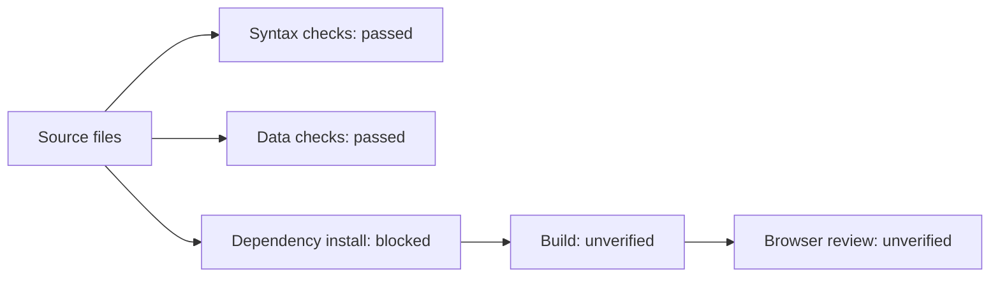
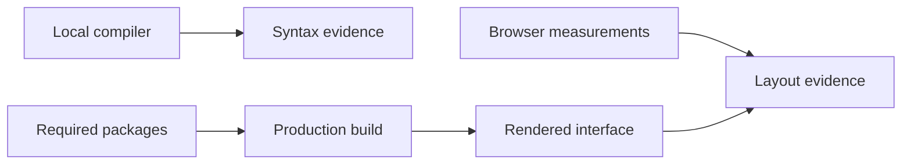

# Frontend source verification

Checked on October 22, 2026, in the local Windows workspace.

## Passed checks

| Check | Result |
| --- | --- |
| JavaScript and JSX syntax | 67 source files transpiled without syntax errors using the locally installed TypeScript 6.0.3 compiler. The application remains JavaScript/JSX. |
| Mock module syntax | All seven mock-data modules passed `node --check`. |
| Local import resolution | All inspected relative source imports resolve to files. |
| Preview coverage | 32 entries exist in the static preview registry. |
| Reusable components | 29 JSX component files exist under `src/components`. |
| Illustrations | Six local SVG assets parse as XML. |
| CSS structure | All five stylesheets have balanced declaration blocks. This is a limited structural check, not full CSS validation. |
| Logic exclusions | No `useState`, `useEffect`, `useReducer`, `useContext`, `onClick`, `onSubmit`, or `onChange` implementation was found. |
| User data | Eight directory users: four students, three instructors, and one administrator. |
| Course data | Five course records resolve to shared instructor records. |
| Assignment data | Four current student assignments have pending statuses. |
| Grade summaries | Three graded records total 276 / 300 points, with a mean of 92%. |
| Grade distribution | Distribution counts sum to the three graded records. |
| Rubric | Criterion maximums total 100 points. |
| Shared references | Assignments, announcements, submissions, and grades reference existing shared records. |

TypeScript was used only as an available source-checking tool. It is not an application dependency. No TypeScript application files were added.

## Checks not completed

The package registry was unavailable in the sandbox. The permission request to download dependencies was rejected. React, React DOM, Lucide React, and Vite were not available in the checked local runtime locations.

Therefore, these checks remain unverified:

- Dependency resolution and lockfile generation.
- `vite build` and production asset delivery.
- Runtime rendering of all screens.
- Browser console errors.
- Screenshots at desktop, tablet, and mobile widths.
- Measured color contrast, focus order, and screen-reader output.
- Visual layout and overflow at 320 px.

No screenshot score, runtime success, or production readiness is claimed.

## Complete verification after installation

Run `npm install` and `npm run build`. Start Vite with `npm run dev`. Select each preview in `src/App.jsx` and review it at 1440, 1024, 768, 390, and 320 px. Check keyboard focus, native field behavior, table scrolling, document preview, and reduced-motion preferences. Finally, run `npm run preview` to check the production output and local SVG assets.

The diagram shows the verification stages. Source checks passed; build and browser stages remain open.

The dependency graph shows why syntax checks do not prove browser behavior.

